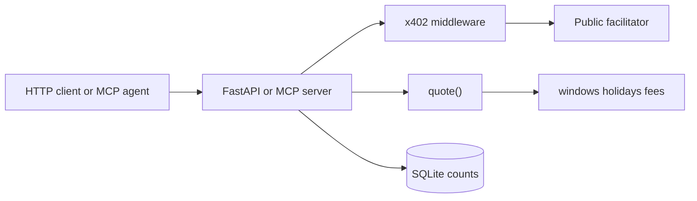

# Architecture

SettleQuote is a pure ranking function with two paid fronts. It does not hold buyer funds, and it does not send ACH, wires, or USDC for the customer.

## quote()

`settlequote.engine.quote.quote` takes a payload, an optional `now`, and an optional gas source. It returns a dict. Tests call it with a frozen clock, so a Fed holiday or a Friday at 4:50 p.m. ET does not depend on the machine clock.

The engine loads three JSON files:

- `windows.json` — Fed and NACHA operating windows, the Fedwire customer cutoff, and the assumed sending-bank morning open.
- `holidays.json` — observed Federal Reserve banking closures.
- `fee_bands.json` — published operator fees and the customer-fee estimates that are never used to rank.

USDC network cost is a static $0.01 per rail from `StaticGas`, labeled `data_status: static`. There is no live RPC gas quote.

Eligibility follows the receiver. A bank account sees only fiat rails. A Base address sees only USDC on Base. A Solana address sees only USDC on Solana. `either` sees all seven. Among rails that are eligible and meet the deadline, non-conditional rails with a non-null operator fee win, lowest fee first, then earliest settlement. If only RTP or FedNow meet the deadline, the cheapest priced conditional rail is recommended and the reason says participation was not checked.

## HTTP

`settlequote.api` serves:

| Route | Role |
| --- | --- |
| `GET /` | Sample request and the decision from a real `quote()` call |
| `GET /health` | Process check |
| `GET /v1/methodology` | Rules version and disclaimer |
| `GET /dashboard` | Aggregate counts |
| `POST /v1/quote/free` | Ten successful quotes per hashed IP per UTC day |
| `POST /v1/quote` | Paid quote |

When `PAY_TO` is set, x402 middleware wraps only `POST /v1/quote`. The scheme is `exact` on `eip155:84532`, price `$0.005` (5000 atomic units of USDC). The facilitator URL defaults to `https://x402.org/facilitator`. `sync_facilitator_on_start` is true so the server loads supported schemes before the first request. Headers are the v2 names: `PAYMENT-REQUIRED`, `PAYMENT-SIGNATURE`, `PAYMENT-RESPONSE`.

A 402 is logged as `payment_required`. A 200 after settlement is logged as `paid`, with the transaction id and a hash of the payer address. Raw IPs and full payer addresses are not stored. The free-tier identity is `Fly-Client-IP` on Fly. `X-Forwarded-For` is not read. The hash salt is `IP_HASH_SALT`, and the process will not start without it. The free route never enters the payment middleware.

The Fly app mounts a volume at `/data` and sets `SQLITE_PATH=/data/settlequote.db`. Counts on the public dashboard are that database. A settlement made against a local MCP server does not appear there.

## MCP

`settlequote.mcp_server` registers `describe_payment_rails` for free. With `PAY_TO` set it also registers `quote_payment_rails` behind `create_payment_wrapper`. The resource description is a pydantic `ResourceInfo` from `x402.schemas`. A `QuoteError` is raised before settlement, so a bad payload does not charge.

`settlequote.agent` is a fixed demo, not a language model. It loads `BUYER_PRIVATE_KEY` from the environment or `agent/.env`, caps the payment at 5000 atomic units, calls the free tool, then calls the paid tool. The buyer key is never read by the server.

## Deployment boundary

The image installs the package and the HTTP extras of x402. It does not install the MCP extra, and `.dockerignore` excludes `agent/`, tests, and every `.env`. The server holds the public `PAY_TO` address and the `IP_HASH_SALT` secret. It does not hold the buyer key.
